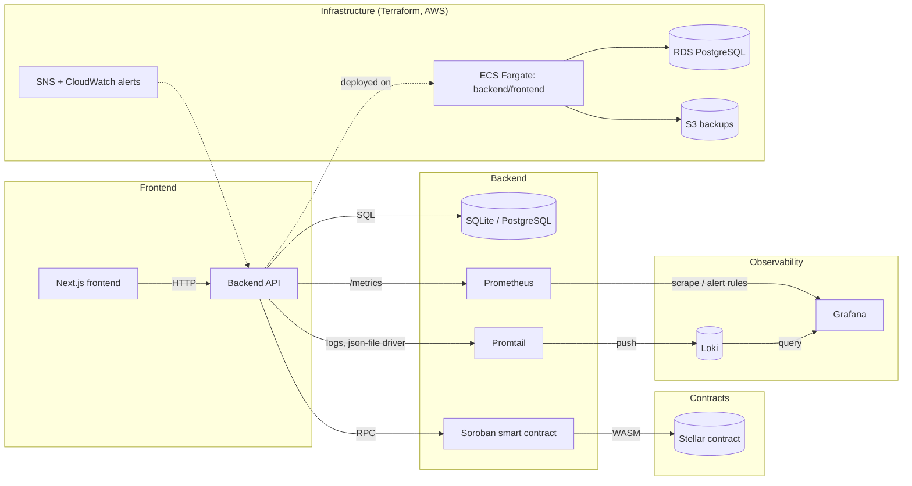
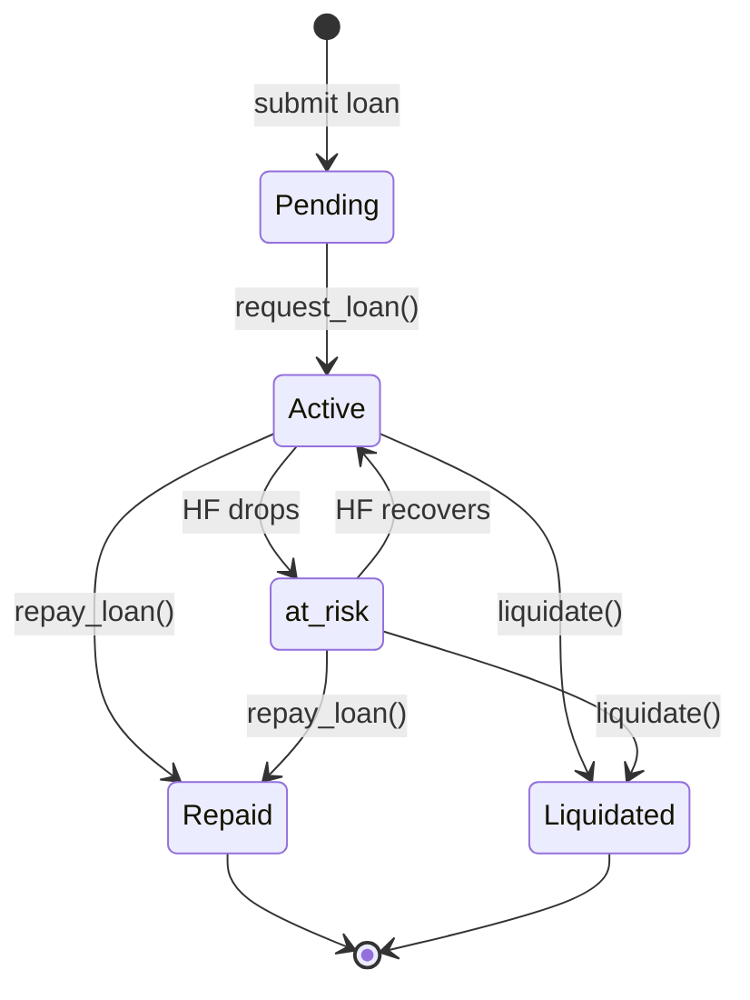

# StellarKraal

[](https://github.com/teslims2/StellarKraal-/actions/workflows/backend-ci.yml)
[](https://github.com/teslims2/StellarKraal-/actions/workflows/frontend-ci.yml)
[](https://github.com/teslims2/StellarKraal-/actions)
[](LICENSE)


link to website https://kraal-bloom-connect.lovable.app/

## Project Overview

StellarKraal enables livestock-backed loans on the Stellar network. Animals are registered as collateral and borrowers can request loans against their appraised value, with on-chain loan lifecycle management and liquidation protection.

See the [CHANGELOG](CHANGELOG.md) for release notes and upcoming changes.

## Architecture



### Architecture Summary

- Frontend: React + Next.js 14 with Tailwind CSS.
- Observability: backend metrics are scraped by Prometheus (alert rules in [`observability/prometheus-rules.yml`](observability/prometheus-rules.yml)); container logs are shipped by Promtail to Loki; Grafana visualizes both. See [docs/observability.md](docs/observability.md).
- Infrastructure: Terraform ([`terraform/`](terraform/) and [`infrastructure/`](infrastructure/)) provisions AWS resources (ECS Fargate, RDS, S3, VPC, backups, SNS/CloudWatch alerting) for staging/production.
- Backend: Node.js + TypeScript + Express.
- Smart contract: Rust using the Soroban SDK.
- Infrastructure: Docker, Docker Compose, local SQLite database.

### Loan State Machine



Full documentation: [Loan State Machine](docs/protocol/loan-state-machine.md)

## Liquidation Mechanism

A loan becomes liquidatable when its **health factor (HF)** falls below `1.0`:

```
HF = (collateral_value × liquidation_threshold) / outstanding_debt
```

Liquidations are **partial**: a liquidator repays a portion of the outstanding debt and receives a proportional slice of collateral plus a **liquidation bonus**. The bonus is paid out of the seized collateral, so the borrower's remaining position is reduced but not wiped out unless the liquidator repays the full debt.

### Liquidation bonus

```
collateral_seized = debt_repaid × (1 + liquidation_bonus)
bonus_paid        = debt_repaid × liquidation_bonus
```

- `liquidation_bonus` is a protocol parameter (e.g. `0.05` = 5%).
- The bonus is **distributed to the liquidator** as extra collateral value on top of the debt they repaid; the protocol does not take a cut of the bonus.
- Seized collateral is deducted from the borrower's collateral balance at the appraised value used for the HF calculation.

### Worked examples (partial liquidation)

Assume `liquidation_threshold = 0.80` and `liquidation_bonus = 0.05` throughout.

**Example 1 — small partial liquidation**

| Field | Value |
|---|---|
| Collateral value | 10,000 |
| Outstanding debt | 8,500 |
| HF before | (10,000 × 0.80) / 8,500 = **0.94** (liquidatable) |
| Debt repaid by liquidator | 1,000 |
| Collateral seized | 1,000 × 1.05 = **1,050** |
| Bonus to liquidator | 1,000 × 0.05 = **50** |
| Collateral after | 10,000 − 1,050 = 8,950 |
| Debt after | 8,500 − 1,000 = 7,500 |
| HF after | (8,950 × 0.80) / 7,500 = **0.955** (still liquidatable) |

**Example 2 — partial liquidation that restores health**

| Field | Value |
|---|---|
| Collateral value | 10,000 |
| Outstanding debt | 8,500 |
| HF before | **0.94** (liquidatable) |
| Debt repaid by liquidator | 2,500 |
| Collateral seized | 2,500 × 1.05 = **2,625** |
| Bonus to liquidator | 2,500 × 0.05 = **125** |
| Collateral after | 10,000 − 2,625 = 7,375 |
| Debt after | 8,500 − 2,500 = 6,000 |
| HF after | (7,375 × 0.80) / 6,000 = **0.983** (still liquidatable) |

**Example 3 — partial liquidation that clears the re-liquidation threshold**

| Field | Value |
|---|---|
| Collateral value | 10,000 |
| Outstanding debt | 8,500 |
| HF before | **0.94** (liquidatable) |
| Debt repaid by liquidator | 3,500 |
| Collateral seized | 3,500 × 1.05 = **3,675** |
| Bonus to liquidator | 3,500 × 0.05 = **175** |
| Collateral after | 10,000 − 3,675 = 6,325 |
| Debt after | 8,500 − 3,500 = 5,000 |
| HF after | (6,325 × 0.80) / 5,000 = **1.012** (safe) |

### Avoiding re-liquidation

After a partial liquidation the borrower remains exposed unless the resulting health factor is **strictly greater than `1.0`** (the protocol's `re_liquidation_threshold`). A position with `HF ≤ 1.0` can be liquidated again in the next block. Borrowers should either:

- repay enough debt themselves, or
- add collateral,

so that `HF > 1.0` after any liquidation event. In Example 3 above the borrower ends at `HF = 1.012` and is no longer liquidatable; Examples 1 and 2 leave the position below `1.0` and open to further partial liquidations.

### Liquidator's guide

1. **Monitor** — watch for loans whose `HF < 1.0` (the backend exposes this via the loan status endpoint and the `at_risk` state).
2. **Choose a repayment amount** — any amount up to the outstanding debt. Repaying more seizes more collateral and pushes the borrower's HF higher.
3. **Trigger** — call `liquidate(loan_id, amount)` on the Soroban contract (or use the frontend liquidation action). The contract transfers `amount` of the debt asset from the liquidator, marks the loan `Liquidated` if fully repaid, and otherwise keeps it `Active`/`at_risk`.
4. **Receive collateral** — the contract transfers `amount × (1 + liquidation_bonus)` of collateral value to the liquidator. Profit is `bonus_paid` minus any transaction fees and slippage on converting seized collateral back to the debt asset.
5. **Verify** — confirm the borrower's post-liquidation HF. If it is still `≤ 1.0`, the position can be liquidated again.

## Local Development

> For a detailed, platform-specific walkthrough see **[docs/development/local-setup.md](docs/development/local-setup.md)**.

### Prerequisites

Ensure the following minimum versions are installed before you begin:

| Tool | Minimum version | Install |
|------|-----------------|---------|
| Node.js | **20.x** | [nodejs.org](https://nodejs.org/) or `nvm install 20` |
| npm | **10.x** (bundled with Node 20) | — |
| Rust | **1.78+** | `curl --proto '=https' --tlsv1.2 -sSf https://sh.rustup.rs \| sh` |
| stellar-cli | **22+** | `cargo install --locked stellar-cli --features opt` |
| Docker & Docker Compose | **24+** (optional, for containerised setup) | [docs.docker.com](https://docs.docker.com/get-docker/) |
| Freighter | latest | [freighter.app](https://www.freighter.app/) (browser extension) |

Verify your environment:

```bash
node --version   # v20.x or higher
npm --version    # 10.x or higher
rustc --version  # 1.78.x or higher
stellar --version # 22.x or higher
```

### Clone and setup

```bash
git clone https://github.com/<your-username>/StellarKraal-.git
cd StellarKraal-
cp .env.example .env
```

### Environment Variables

Create a `.env` file in the project root containing:

| Variable | Description | Example |
|---|---|---|
| `NEXT_PUBLIC_NETWORK` | Stellar network to use | `testnet` |
| `RPC_URL` | Soroban JSON-RPC endpoint | `https://soroban-testnet.stellar.org` |
| `CONTRACT_ID` | Deployed Soroban contract ID | `G...` |
| `PORT` | Backend service port | `3001` |
| `NEXT_PUBLIC_API_URL` | Frontend API base URL | `http://localhost:3001` |
| `SHUTDOWN_TIMEOUT_MS` | Graceful shutdown drain timeout (ms, min 1000, default 10000). On SIGTERM/SIGINT the server stops accepting new connections and waits up to this duration for in-flight requests to complete before forcing exit. | `10000` |

### Run with Docker Compose

```bash
docker-compose up --build
```

Access:

- Frontend: `http://localhost:3000`
- Backend API: `http://localhost:3001`

### Pulling pre-built images (Apple Silicon / arm64)

GHCR images are published as multi-arch manifests covering `linux/amd64` and `linux/arm64`. Docker Desktop on Apple Silicon automatically selects the native arm64 layer — no `--platform` flag needed.

```bash
# Pull latest images (arm64 selected automatically on Apple Silicon)
docker pull ghcr.io/teslims2/stellarkraal-backend:main
docker pull ghcr.io/teslims2/stellarkraal-frontend:main

# Or run directly — Docker resolves the correct arch from the manifest
docker run --rm -p 3001:3001 ghcr.io/teslims2/stellarkraal-backend:main
docker run --rm -p 3000:3000 ghcr.io/teslims2/stellarkraal-frontend:main
```

To verify you received the native arm64 image:

```bash
docker inspect ghcr.io/teslims2/stellarkraal-backend:main | grep Architecture
# Should print: "Architecture": "arm64"
```

### Run without Docker

#### Backend

```bash
cd backend
npm install
npm run build
npm start
```

#### OpenAPI Specification Generation

To auto-generate `openapi.json` from in-code `@openapi` route annotations:

```bash
cd backend
npm run openapi:generate
```

This scans all annotated route handlers, generates `backend/openapi.json`, and updates the spec version to match `package.json`. CI automatically verifies that `openapi.json` is not stale.

#### Frontend

```bash
cd frontend
npm install
npm run dev
```

#### Smart contract tests

```bash
cd contracts/stellarkraal
cargo test
```

### Common Setup Errors

| Symptom | Cause | Resolution |
|---------|-------|------------|
| `nvm: command not found` | nvm not installed | Install via [nvm install guide](https://github.com/nvm-sh/nvm#installing-and-updating), then `nvm install 20` |
| `npm ERR! code ERESOLVE` | Node version mismatch | Ensure Node.js 20+ (`node --version`). Delete `node_modules` and re-run `npm install`. |
| `sqlite3` build error | Missing native build tools | Run `npm rebuild sqlite3` after installing system build tools (see [local-setup.md](docs/development/local-setup.md)) |
| `stellar: command not found` | `~/.cargo/bin` not in PATH | Add `export PATH="$HOME/.cargo/bin:$PATH"` to your shell profile |
| `error[E0463]: can't find crate` | Wrong Rust toolchain | Run `rustup target add wasm32-unknown-unknown` inside `contracts/stellarkraal/` |
| `PORT already in use` | Port 3001 occupied | Stop the conflicting process or set a different `PORT` in `.env` |
| `Cannot conn

/* … truncated 9874 chars — edit only what you need near the top … */
